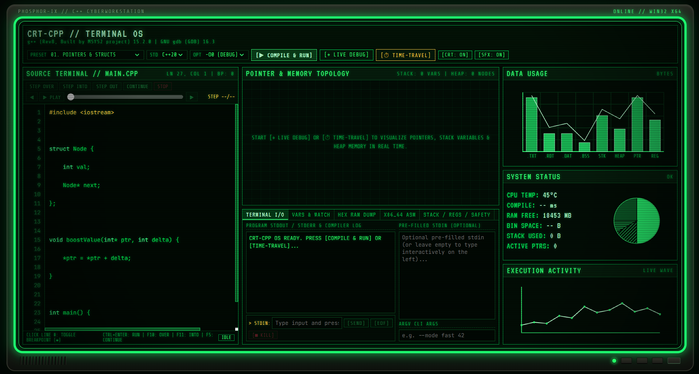

# CRT-CPP // TERMINAL OS — Web C++ IDE & Visual Memory Debugger

A retro **CRT Phosphor Green** web-based C++ IDE, compiler, interactive GDB debugger, and real-time pointer/memory visualizer.



## Key Features

- **C++ Editor, Compiler & Runner (`g++`)**:
  - Supports `C++17`, `C++20`, and `C++23` standards with selectable optimization levels (`-O0`, `-O2`, `-O3`).
  - Syntax highlighting, line numbers, custom `stdin` input, and CLI `argv` arguments.
  - Includes 5 built-in presets: *Pointers & Structs*, *Linked List Heap Graph*, *Recursion & Call Stack*, *Array Telemetry Sort*, and *Null Ptr Crash Detective*.
- **Live GDB Debugger (`GDB MI2`)**:
  - Click line numbers in the gutter to toggle **Breakpoints (`●`)**.
  - Full stepping controls: **Step Over (`F10`)**, **Step Into (`F11`)**, **Step Out (`Shift+F11`)**, **Continue (`F5`)**, and **Stop**.
  - Automatically filters out STL/CRT internal frames to keep execution focused on user code.
- **Time-Travel Execution Recorder**:
  - Captures a complete step-by-step execution trace so you can scrub backward/forward through every line or auto-play (`▶ PLAY`) to inspect variable mutations over time.
- **Pointer & Memory Topology (Stack / Heap Schematic)**:
  - Dynamically draws Stack variables, Heap allocations (`new`), memory addresses (`0x...`), byte sizes, and `nullptr` indicators.
  - Renders vector arrows connecting pointers to target variables or chained **Linked List** nodes (`head -> next -> ...`).
- **Advanced Inspection Tools**:
  - **Vars & Watch + GDB Eval**: Inspect types, addresses, dereferenced values (`*ptr`), mutation highlights, custom watch expressions, and live GDB expression evaluation.
  - **Hex RAM Dump**: View 64-byte raw memory blocks (Hex + ASCII); click any variable or heap node in the topology diagram to jump straight to its RAM region.
  - **x86_64 Disassembly**: View compiled assembly instructions via `objdump -d -S -C`.
  - **Call Stack, CPU Registers & Static Safety Analyzer**: Inspect call stack backtraces, CPU registers (`PC`, `SP`, `FP`, `RAX`, `RBX`, `RCX`, `RDX`), and static allocation checks (`new`/`delete`, `malloc`/`free`, uninitialized pointers).
- **CRT Telemetry Dashboard & Retro FX**:
  - Live `DATA USAGE` bar/line chart, `SYSTEM STATUS` metrics with hatched pie chart, and `EXECUTION ACTIVITY` waveform.
  - Toggleable CRT scanlines, phosphor contrast, and retro Web Audio API sound effects.

---

## Project Structure

```text
.
├── docs/
│   └── preview.png     # Application UI screenshot
├── public/
│   ├── index.html      # CRT monitor layout & inspector panels
│   ├── styles.css      # Phosphor green theme, scanlines & responsive layout
│   └── app.js          # Editor, Time-Travel player, SVG Pointer Graph & Telemetry charts
├── server.js           # Node.js HTTP server, g++ compiler, GDB MI2 controller & objdump
├── test-suite.js       # Automated API test suite for compile, debug & time-travel
├── package.json        # Zero-dependency Node.js project manifest
├── Dockerfile          # Node.js 20 + build-essential, g++, gdb & binutils for Render
├── render.yaml         # Render Blueprint configuration
├── .gitignore
└── README.md
```

---

## Local Development

### Prerequisites
- **Node.js** `>= 18`
- **g++**, **gdb**, and **objdump** (`binutils`) available in `PATH` (e.g., MSYS2/MinGW-w64 on Windows or `build-essential gdb binutils` on Linux).

### Start the Server
```bash
npm start
```
Then open `http://localhost:3000` in your browser.

### Run Automated Tests
```bash
npm test
```

> **Security Note**: This application compiles and executes user-submitted C++ code directly inside the server container, making it ideal for learning, demos, or personal use. If exposing publicly to untrusted users, enforce container resource limits and infrastructure-level sandboxing.
